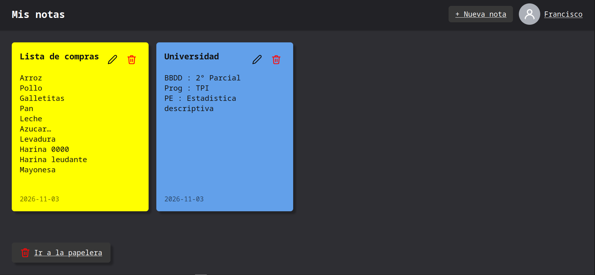

# Notes Hub

Aplicacion web para hacer notas desarrollado en **Spring Boot** con soporte para moviles,
incluye una API REST.



### Indices

- [Caracteristicas](#caracteristicas)
- [Instalacion](#instalacion)
- [API REST](#api-rest)

## Caracteristicas

Utiliza **Spring Security** para la autenticacion, **Hibernate** para el acceso a una base de
datos **Maria DB**, **Thymeleaf** como motor de plantillas, **Spring Mail** para enviar emails y
usa un certificado autofirmado para **SSL**.
<br>
_Las paginas html fueron diseñadas con ayuda de la IA._

## Instalacion

Si planeas instalarlo y usarlo en tu PC o en un servidor podes empezar clonando el repositorio:

```
git clone https://github.com/FranciscoRatti/NotesHub.git
```

Hay ciertas cosas que debes tener en cuenta antes de ejecutar la aplicacion:

- Debes tener una base de datos relacional. la aplicacion usa Maria DB como gestor de base de
  datos, si usas otro debes cambiar el driver de Maria por el de tu gestor en las dependencias en
  el [**pom.xml**](pom.xml), podes buscar el driver en los [repositorios de maven](https://mvnrepository.com/).
- Chequea el archivo **aplication.properties**, hay algunas propiedades que tenes que cambiar:
  - **app.url** debe coincidir con la url para acceder a la aplicacion, si queres que solo
    se acceda desde tu red podes remplazarlo por _https://\<ip\>:8443_.
  - **spring.datasource.\*** para configurar la base de datos.
  - **spring.mail.\*** para configurar a que nombre se envian los emails.

Luego de configurar la aplicacion podes ejecutar usando:

```
./mvnw spring-boot:run
```

Si queres que se genere un **.jar** podes ejecutar:

```
./mvnw clean package
```

Y revisa el directorio **target/**, ahi vas a encontrar un archivo llamado
**noteshub-\<version\>.jar**, lo podes ejecutar en cualquier lugar donde haya una base de datos
que respete la configuracion, para ejecutar usas:

```
java -jar noteshub-<version>.jar
```

## API REST

La aplicacion tiene una API REST para ejecutar operaciones sobre las notas del usuario, para la
autenticacion usa **httb basic**. A continuacion se muestran todos los endpoints especificando
metodo http:

- `<url>/api/notes/all GET` : Devuelve todas las notas del usuario.
- `<url>/api/notes/{id} GET` Devuelve la nota con el id.
- `<url>/api/notes/new PUT` : Crea una nueva nota, se debe incluir en el cuerpo un objeto Note.
- `<url>/api/notes/update/<id> PUT` : Actualiza el contenido de la nota con el id, se debe enviar un
  objeto Note en el cuerpo.
- `<url>/api/notes/trash/<id> DELETE` : Envia a la papelera la nota con el id.
- `<url>/api/notes/restore/<id> POST` : Restaura una nota de la papelera.
- `<url>/api/notes/remove/<id>` : Elimina permanentemente una nota.
- `<url>/api/notes/clean-trash` : Elimina permanentemente todas las notas de la papelera.

Para usar cada uno de estos endpoints en una aplicacion podes usar **curl** de la siguiente manera:
Para peticiones sin cuerpo:

```
curl -sk -X <METODO> -u "<usuario>":"<contraseña>" <url>
```

Para peticiones que incluyen un objeto de tipo Note en el cuerpo:

```
curl -sk -X <METODO> -u "<usuario>":"<contraseña>" <url> \
  -H "Content-Type: application/json" -d '{"title":"<titulo>","body":"<cuerpo>","color":"<color>"}'
```

A la hora de hacer una peticion a **/api/notes/new** los campos que se dejen vacios tomaran el
valor predeterminado.
En cambio, a la hora de hacer una peticion a **/api/notes/update/\<id\>** los campos que se dejen
vacios no se cambiaran.
